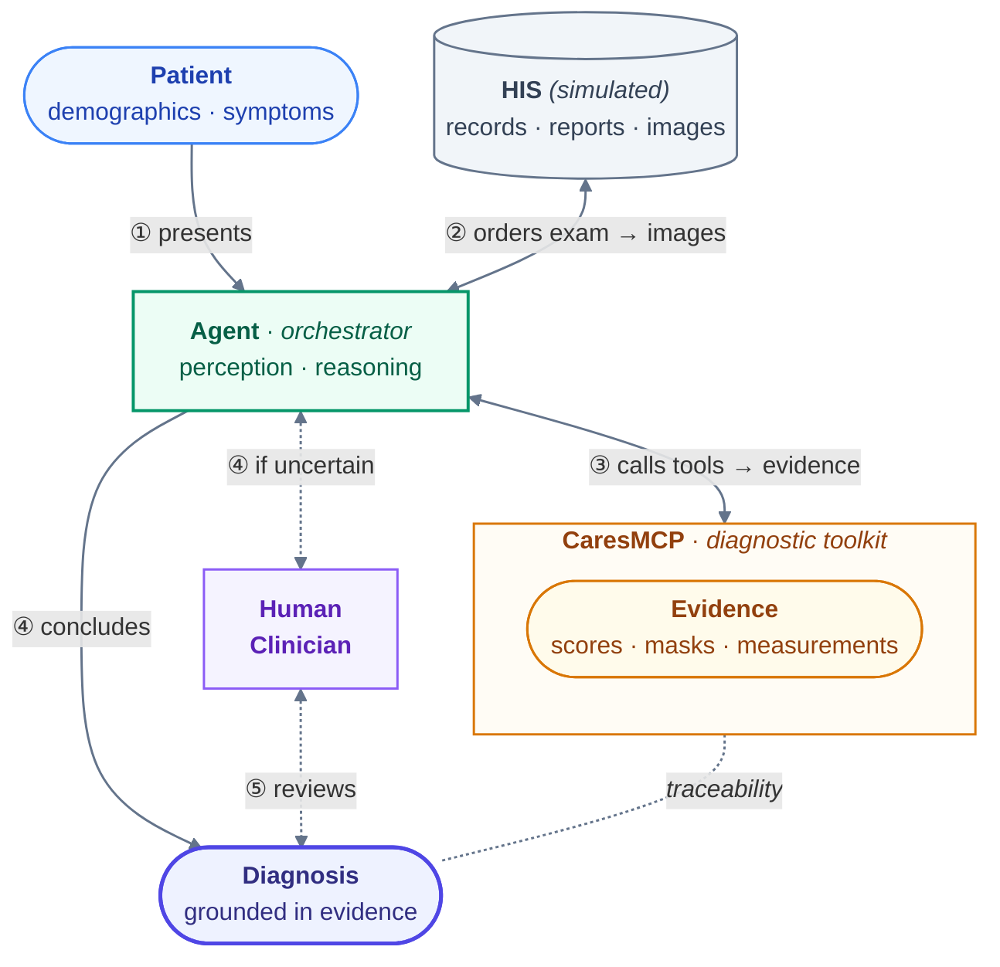

# CaresMCP

[](https://doi.org/10.5281/zenodo.24521705)
[](https://pypi.org/project/caresmcp/)
[](https://www.python.org/downloads/release/python-3120/)
[](https://caresmcp.readthedocs.io/)

Medical imaging tools for AI agents, served over the Model Context Protocol
(MCP). CaresMCP wraps dedicated medical models behind 50+ callable tools and
returns evidence an agent can cite: scores, masks, heatmaps, measurements, and
embeddings.

**Package:** <https://pypi.org/project/caresmcp/> ·
**Documentation:** <https://caresmcp.readthedocs.io/>

Starting from the patient's presentation, an agent proactively orders
examinations, calls medical imaging tools on the studies, and grounds its
diagnosis in the evidence:



## Quick start

```console
uv tool install "caresmcp[xray]"
caresmcp list xray
caresmcp debug xray torchxrayvision_classify \
  '{"image_or_dicom": "https://nih-chest-x-rays.s3.us-east-2.amazonaws.com/images_1024x1024/00000003_001.png"}'
```

The first model-backed call downloads its checkpoint. To serve the tools over
MCP:

```console
caresmcp mcp
claude mcp add --transport http caresmcp http://127.0.0.1:8000/mcp
```

Full walkthrough, output examples, and troubleshooting:
[Getting started](https://caresmcp.readthedocs.io/en/latest/quick-start.html).

## Documentation

- [Capabilities](https://caresmcp.readthedocs.io/en/latest/capabilities/) —
  browse tools by task or modality; the catalog is generated from the registry.
- [Concepts](https://caresmcp.readthedocs.io/en/latest/concepts.html) — tools,
  categories, tasks, models, and the input/output contract.
- [Model coverage](https://caresmcp.readthedocs.io/en/latest/coverage/) —
  integrated, deferred, and out-of-scope models with access terms.
- [Installation](https://caresmcp.readthedocs.io/en/latest/installation.html) —
  PyPI, extras, and source installs.
- [Limitations and safety](https://caresmcp.readthedocs.io/en/latest/limitations.html) —
  research use, checkpoint licenses, and privacy.
- [CaresAgentBench (WIP)](https://caresmcp.readthedocs.io/en/latest/caresagentbench.html) —
  the agent benchmark pilot and its work-in-progress status.
- [Contributing](https://caresmcp.readthedocs.io/en/latest/contributing.html) —
  add a tool or update a model survey.

CaresMCP is research software, not a medical device. Check each upstream
checkpoint's license and access terms before use.
