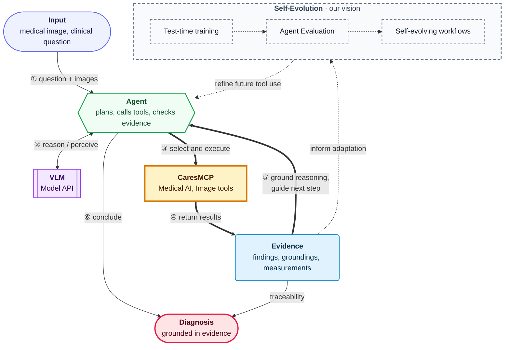
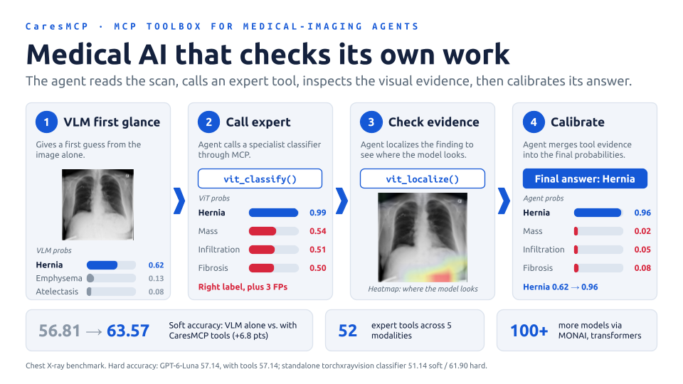
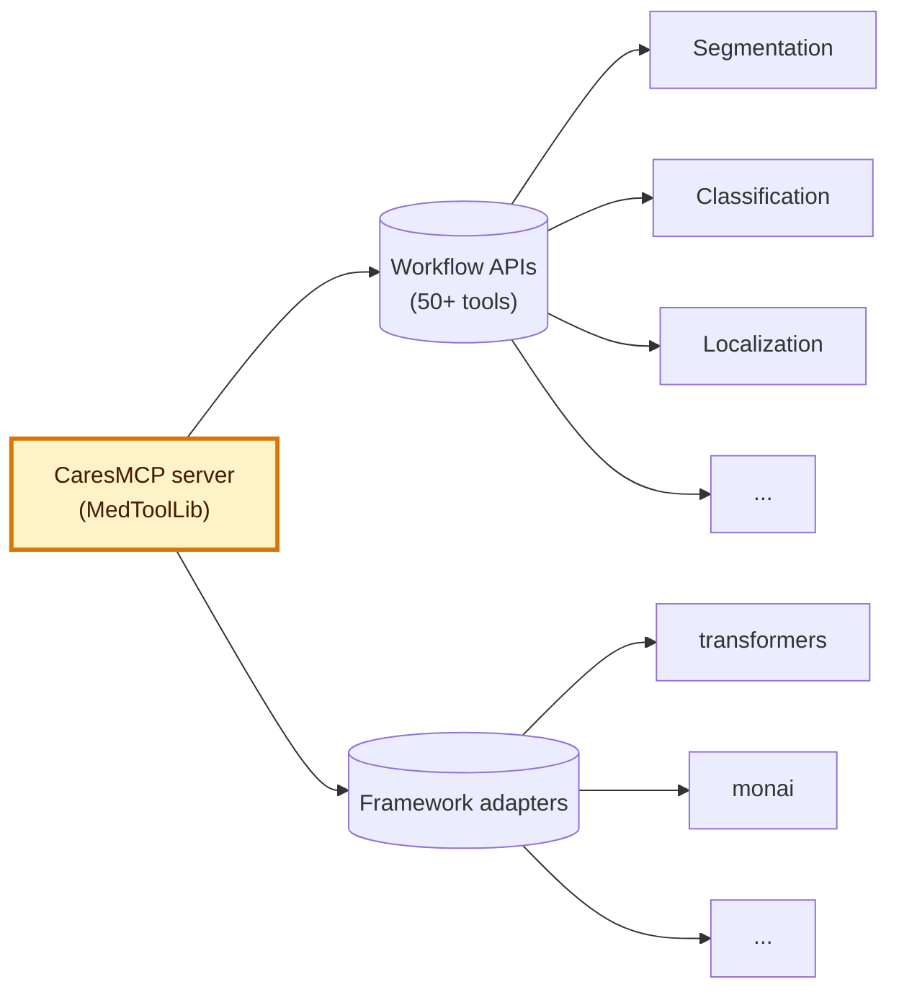
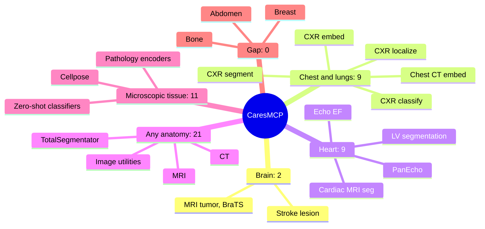
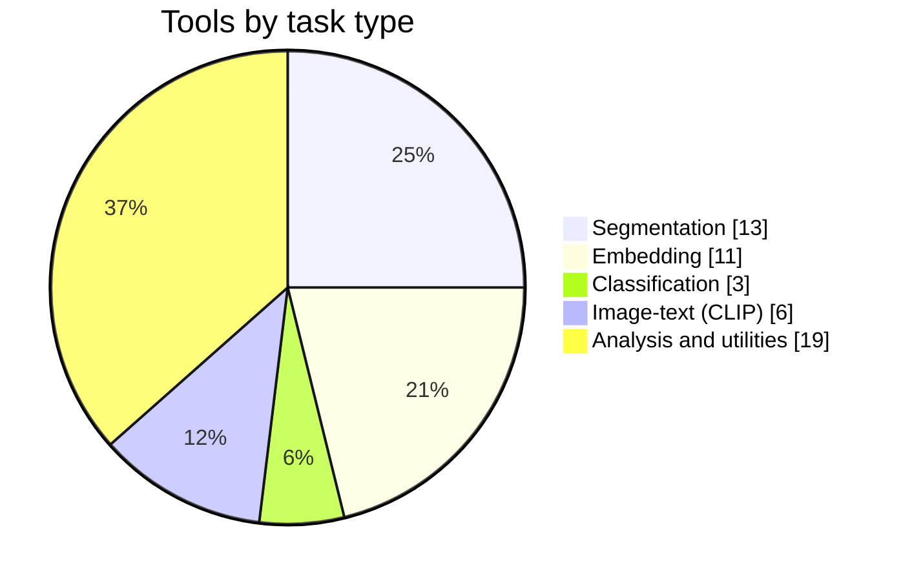
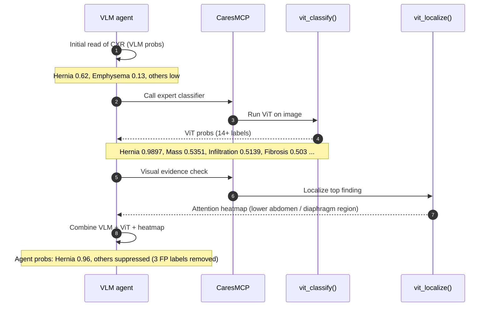

# CaresMCP

CaresMCP brings dedicated medical ML models & tools to agents through
the Model Context Protocol (MCP). Our goal is to help medical vision-language
models (VLMs) overcome bottlenecks in medical reasoning, data sourcing, and
interpretability: diagnostic conclusions should be traceable to evidence and
even to individual images. These tools also provide a foundation for test-time training and
self-evolving agent workflows.

## Architecture

We support over 100 models or tools with dedicated end-to-end workflow function APIs,
and generic adapters to popular libraries.

## Coverage by Body-Part and Modality

## Example workflow: chest X-ray with expert-tool calibration

A VLM alone can be unsure or distracted by spurious findings. CaresMCP lets the agent call an expert classifier, then verify visually, and use the result to calibrate its own probabilities (test-time calibration).

- The expert classifier raises confidence in the true label (0.62 to 0.96 after calibration).
- The visual-evidence step filters out distractors, removing 3 false-positive labels and improving accuracy.
- The agent output acts as test-time calibration of the VLM using tool evidence.

## CXR Benchmark Pilot Study

```mermaid
xychart-beta
    title "Chest X-ray accuracy (%)"
    x-axis ["GPT-6-Luna", "torchxrayvision", "GPT-6-Luna + tool"]
    y-axis "Accuracy" 40 --> 70
    bar [56.81, 51.14, 63.57]
    bar [57.14, 61.90, 57.14]
```

Agent gives the best **soft** accuracy (63.57), while the standalone classifier is best on **hard** accuracy (61.90).
